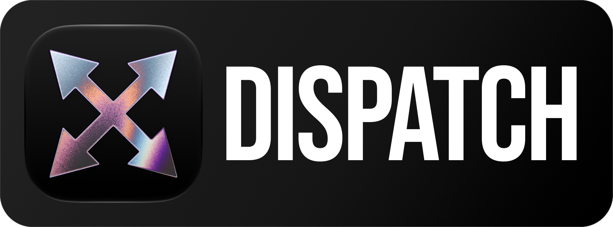

<p align="center">
  
</p>

# Polterware Dispatch

Dispatch delegates a task to a coding-agent CLI (Codex, Claude Code, Cursor, Grok, OpenCode, Pi, Gemini, Qwen, Copilot, Kimi, Antigravity, or any ACP agent you add), routed by difficulty and quota, and keeps each run's transcript, routing decision, usage, and worktree. Agents start runs with `dispatch run` or the Dispatch skill; the desktop app follows, merges, and tunes them. It is part of the [Polterware](https://github.com/polterware/polterware) ecosystem and works on plain folders without it.

## How it works

- **One binary.** `Dispatch.app` holds a single Rust executable. Opened from the Finder it is the desktop app; given a command, or run as `dispatch` (`Contents/Resources/dispatch` links to it, and `dispatch setup link` puts it at `~/.local/bin/dispatch`), it is the CLI and the core.
- **The core.** `dispatch serve` is the only process that opens `dispatch.db` (`$PWDISPATCH_DATA_DIR`, else `~/Library/Application Support/Polterware Dispatch`). It serves `dispatch.v1` over Connect (JSON and binary proto) on loopback, behind a session token kept in `run/core.json`. Any `dispatch` command starts it when none is running, and `dispatch stop` stops it.
- **Routing.** With a difficulty classifier on (`dispatch config set classifier jev|openai|cli`), Auto estimates how hard the task is and picks the cheapest model the benchmarks (CursorBench, else the Epoch Capabilities Index) expect to pass it, weighed by each account's quota. A tier (`--tier easy|normal|hard`) runs that tier's table in order instead. Roles (explorer, implementer, tester, reviewer, planner, or your own) add instructions, access, and their own model boards.
- **Runs.** A write run gets its own git worktree and branch; `dispatch merge` brings it back. Usage and the API-equivalent cost are read from each agent CLI's own stream; quota only from the CLIs' official protocols.
- **Agents reach it** through the CLI and the skill (`dispatch setup`; one copy in `~/.agents/skills` serves most agents, Claude Code and Antigravity read their own folders), a SessionStart hook per agent that has them (Claude Code, Codex, Cursor, Gemini CLI, Qwen Code, Copilot, Grok), and an OpenCode plugin that swaps OpenCode's subagent tool for dispatch runs. There is no MCP server.

## Use

```bash
dispatch run --dir <repo> - <<'BRIEF'
<goal; what it may touch; the test command; report in <= 10 lines>
BRIEF
dispatch wait <id> --timeout 9m     # exit 3 while it still runs
dispatch result <id> --section agent
dispatch merge <id>
```

| Command | Does |
| --- | --- |
| `run`, `wait`, `status`, `result`, `cancel`, `runs` | Start and follow runs |
| `merge`, `clean`, `recover` | Bring a run's worktree back, discard it, or save an interrupted one |
| `route`, `classify`, `models [refresh\|bench]` | Show how a prompt would route, the classifier's answer, and the model catalog |
| `tiers [--check\|build]`, `roles`, `config`, `agents` | Tune the tier table, roles, the routing policy, and the agent list |
| `usage`, `doctor` | Stats and spend; the installed CLIs and their capabilities |
| `setup`, `skill`, `on`, `off`, `hook`, `update` | Wire the agent CLIs to dispatch |
| `workspace ls\|add\|rm`, `serve`, `stop` | Workspaces and the core |

`dispatch skill show` prints the full guide agents read.

## Layout

- `crates/dispatch-core`: the core and the CLI (`dispatch_core::server`, `dispatch_core::cli`): routing, runs, the store, the agent adapters, the classifiers, and the setup of the agent CLIs.
- `app`: the desktop app in GPUI (`dispatch-app`), on [polterware/ui](https://github.com/polterware/ui), and the binary's entry. The window reads the core over Connect-JSON and never opens SQLite.
- `schemas`: the `dispatch.v1` contracts and `polterware/local/v1/dispatch_host.proto`, the `DispatchHostService` Polterware serves to Dispatch. Polterware vendors these files; change them here.
- `plugins/opencode-gui`: the OpenCode Desktop plugin (Solid), built into the file `crates/dispatch-core` embeds.
- `tooling`: the checks, the model catalog (`models.mjs`), the classifier evaluation (`classify-eval.mjs`), the release bundle (`release/bundle.sh`), and the Sparkle updater (`updater`).
- `docs/assets`: the icon, the README banner, and the cover (the repository's social preview).
- `updates/dispatch.xml`: the Sparkle appcast the app checks daily.

## Develop

```bash
cargo build -p dispatch-core --bin dispatch
./target/debug/dispatch serve &
cargo run -p dispatch-app
```

The `dispatch` bin target is the same CLI the app binary runs, on its own for development. `crates/dispatch-core` compiles the protos with `protoc` (`PROTOC` names it when it is not on `PATH`).

## Checks

```bash
bash tooling/verify.sh
```

This runs `buf lint`, the plugin tests, `cargo fmt --check`, `clippy`, and `cargo test`, the plugin's typecheck and build check, and the boundary check.

## Release

`bash tooling/release/bundle.sh <version>` builds `Dispatch.app` for macOS arm64, with its ZIP, DMG, checksums, and signed appcast. Pushing a `dispatch-v<version>` tag runs the release workflow, which attaches them to a draft GitHub release. Builds are signed ad hoc and not notarized.

## License

Apache-2.0. Third-party code and data keep their own licenses; see [NOTICE](NOTICE).
